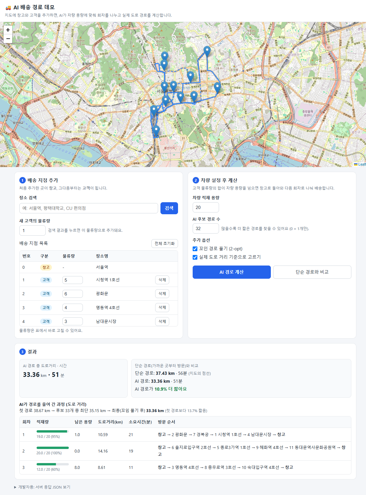

# 🚚 자동배송 시스템 (CVRP Road)
## AI 기반 용량 제약 배송 경로 최적화(CVRP) + 실제 도로 경로(OSRM) 웹 데모

<div align="center">

[](https://github.com/seokhyu-n/cvrp-road-demo/actions/workflows/tests.yml)
[](https://fastapi.tiangolo.com/)
[](https://pytorch.org/)
[](https://leafletjs.com/)
[](https://render.com/)

**“지도에서 장소를 찍으면, AI가 회차(Trip)를 나눠 최적 배송 경로를 제안합니다.”**

**Live Demo:** https://cvrp-road-demo.onrender.com/

</div>

> **버전 안내**
> - **v1 (2025.09 ~ 12)**: 학교 개인 프로젝트로 만든 버전입니다. 코드는 [`v1.0-school`](https://github.com/seokhyu-n/cvrp-road-demo/tree/v1.0-school) 태그에 그대로 보존되어 있습니다.
> - **v2 (2026.11)**: v1을 다시 점검해 **같은 학습 모델로** 추론·평가·서비스를 개선한 버전입니다. 지금 저장소와 라이브 데모가 v2입니다.

---

## 🔄 v1 → v2 한눈에 보기

| 항목 | v1 · 학교 프로젝트 | v2 · 개선 |
|---|---|---|
| **경로 길이 vs OR-Tools** (실제 도로 거리, 고객 20명) | OR-Tools보다 30.5% 김 | **OR-Tools보다 11.2% 김** |
| **경로 길이 vs OR-Tools** (실제 도로 거리, 고객 50명) | OR-Tools보다 38.0% 김 | **OR-Tools보다 13.0% 김** |
| **경로 길이 vs Nearest Neighbor** (도로 거리, 평균) | NN보다 **김** — 20명 1.6% · 50명 7.2% | NN보다 **짧음** — 20명 **13.3%** · 50명 **12.2%** |
| 가장 나빴던 경우 vs NN (도로 거리) | NN보다 김 — 20명 30.5% · 50명 28.0% | NN보다 김 — 20명 13.3% · 50명 0.7% |
| 디코딩 | greedy 1회 | greedy + 샘플 32개 중 최단 경로 |
| 후처리 | 용량 기준 회차 분할 | + 회차별 2-opt |
| 경로를 고르는 거리 | 위경도 그대로(min-max 정규화) | **OSRM 실제 도로 거리** (실패 시 보정된 직선거리) |
| 라이브 응답 시간 (고객 8명) | 약 1.2초 (greedy 1회) | 약 1.2초 (후보 33개 + 2-opt + 도로 거리 조회 포함) |
| 평가 | Colab 노트북, NN과만 비교, 재현 코드 없음 | 평가 스크립트 + Run 기록, **OR-Tools 참조해**, 도로 거리 캐시로 재현 가능 |
| 테스트 | 없음 | pytest 36개, PR마다 자동 실행(GitHub Actions) |
| 안정성 | 요청 크기 제한 없음, 모델 파일이 없으면 서버 중단, 에러도 HTTP 200 | 요청 크기 상한, 안전한 체크포인트 로드, 400/502/503 상태 코드, CORS 정리 |
| 사용성 | 일부 브라우저(앱 내장 브라우저 등)에서 고객 추가 불가, 오류가 팝업으로만 표시 | 화면 안 물류량 입력, 탐색 옵션·도로 거리 토글, 단계별 거리 표시, **한글 버튼·단계별(1·2·3) 화면, 오류를 화면 안에 표시, 모바일 대응** |

*같은 평가 인스턴스(서울 근처 11km × 11km, 20명 200개 / 50명 100개)를 OSRM 도로 거리로 잰 결과입니다 (`results/runs.csv` Run-05·06의 A와 E).*
*OR-Tools는 최적에 가까운 해를 구하는 참조 솔버라 "OR-Tools보다 몇 % 긴지"는 **낮을수록 좋습니다**. Nearest Neighbor(가장 가까운 곳부터 방문)는 가장 단순한 기준선으로, v1은 이보다도 길었고 v2는 약 12~13% 짧습니다. 모든 비율은 인스턴스별로 계산한 뒤 평균한 값입니다.*

| v1 실행 화면 | v2 실행 화면 |
|---|---|
|  |  |

### v2에서 한 일

같은 체크포인트(`checkpoints/best.pt`)를 그대로 쓰면서, 문제를 하나씩 찾아 숫자로 확인하며 고쳤습니다.

| # | 발견한 문제 | 해결 | 효과 (OR-Tools보다 몇 % 긴지, 20명 / 50명 · 낮을수록 좋음) |
|---|---|---|---|
| 1 | 학습 때는 창고가 항상 중앙인데, 추론 때는 min-max 정규화라 창고 위치가 제각각. 위경도를 그대로 써서 경도 방향 거리도 왜곡 | 경도에 cos(위도)를 곱하고, 창고를 중앙에 두는 정규화 | 직선 +27.3% / +32.6% → +23.3% / +24.9% |
| 2 | 실험에서는 best-of-20을 썼지만, 데모는 greedy 1회만 실행 | greedy + 샘플 32개 중 최단 경로 선택 (seed 고정) | → +14.6% / +16.4% |
| 3 | 회차 안에서 경로가 꼬이는 경우 | 회차별 2-opt (적재량은 그대로) | → +10.9% / +10.1% |
| 4 | 직선거리로 고른 경로는 실제 도로에서 우위가 줄어듦 (도로 기준 +17.8% / +21.1%) | 후보 선택과 2-opt를 OSRM 도로 거리로 (일방통행 등 비대칭 거리 반영) | 도로 +17.8% / +21.1% → **+11.2% / +13.0%** |
| 5 | 라이브 서버가 고객 8명에 7~9초 | PyTorch 스레드 수 고정 (저사양 컨테이너의 스레드 경합 해소) | 7~9초 → 0.4초 |
| 6 | 개선 효과를 비교·기록할 방법이 없음 | 고정 평가셋 + Run 기록(`results/runs.csv`) + OR-Tools 참조해 + 도로 거리 캐시 | 모든 숫자를 명령 한 줄로 재현 |

자세한 수치는 [📊 v2 평가 결과](#-v2-평가-결과-재현-가능)에 있습니다. 남은 약 11~13%의 차이는 모델 자체의 한계(짧은 학습: 3,000 step, 고객 20명 고정)로 보이며, 재학습이 다음 과제입니다.

---

## 📌 개요

**자동배송 시스템 (CVRP Road)** 는 물류 현장에서 자주 등장하는 **CVRP(Capacitated Vehicle Routing Problem)** 를 대상으로,
딥러닝 기반 경로 생성 모델이 고객 방문 순서를 예측하고, **용량(capacity) 초과 시 자동으로 회차(Trip)를 분할**하며,
각 회차의 이동은 **OSRM 도로 라우팅**으로 실제 도로 거리/시간까지 계산해 시각화하는 웹 데모입니다.

- **CVRP**: 각 고객의 수요(demand)를 싣고 배송할 때, 차량 용량(capacity)을 넘지 않도록 경로를 구성하는 최적화 문제
- 본 프로젝트는 “모델 출력 → 회차 분할 → 도로 거리/시간 계산 → 지도 시각화”까지 **실사용 흐름에 가깝게 연결**했습니다.

### 개발 정보
- **v1 기간**: 2025.09 ~ 2025.12 (학교 개인 프로젝트 · 모델 학습, 백엔드, 프론트엔드, 배포)
- **v2 기간**: 2026.11 (추론 파이프라인·평가 체계·서비스 개선)
- **인원**: 1명

### 배경
- 배송지가 많아질수록 사람이 최적 경로를 직접 짜기 어렵고, 비효율은 시간·연료비·인건비 증가로 이어집니다.
- 차량 용량 안에서 몇 회차로 나눌지까지 함께 고려해야 해 문제 난이도가 크게 올라갑니다.
- CVRP는 NP-hard 문제로, 최근에는 Transformer/Pointer Network 같은 딥러닝 휴리스틱으로 빠르게 좋은 해를 찾는 연구가 활발합니다.

---

## 🎯 목표

- 사용자가 **지도에서 배송 지점(창고 + 고객)** 을 쉽게 구성
- 고객마다 **물류량(demand)** 을 설정
- AI가 **방문 순서 + 회차 분할(trip split)** 을 자동 생성
- OSRM으로 각 회차의 **도로 거리(km) / 시간(분)** 을 계산
- 결과를 표/지도(Polyline)로 제공하여 **설명 가능한 데모**로 제시

---

## ✨ 핵심 기능

### 1) 장소 검색 (Kakao Local API)
- 키워드 기반 장소 검색 결과 리스트 제공
- 검색 결과 클릭 → 지도에 마커 추가
- (Fallback) 키가 없으면 Nominatim(OpenStreetMap)으로 검색 가능

### 2) 배송 지점 관리
- 첫 번째 지점은 **창고(Depot)**, 이후 지점은 **고객(Customer)**
- **새 고객의 물류량** 칸의 값으로 고객 추가, 지점 목록 표에서 바로 수정 *(v2)*
- 고객 삭제 시 인덱스 재정렬 + UI 동기화

### 3) AI 기반 경로 생성 + 회차 분할
- 모델이 예측한 경로에서 **고객 방문 순서만 추출**
- **capacity 기준으로만** depot 복귀를 삽입하여 회차를 구성 (불필요한 depot 반복 제거)
- **best-of-N 샘플링** *(v2)*: greedy 1개 + sampling N개(기본 32) 후보 중 가장 짧은 경로 선택
- **회차별 2-opt** *(v2)*: 각 회차 안에서 꼬인 구간을 풀어 거리 단축 (적재량은 그대로)
- **도로 거리로 선택** *(v2)*: OSRM에서 받은 도로 거리 행렬로 후보를 고르고 2-opt (실패 시 직선거리)

### 4) 도로 거리/시간 계산(OSRM)
- 각 trip별 좌표를 OSRM에 전달
- polyline을 지도에 표시 + 표에 **km/min** 요약
- **단순 경로와 비교** 버튼으로 같은 지점의 Nearest Neighbor(가까운 곳부터 방문) 경로와 도로 거리 비교 → "AI 경로가 ○% 더 짧아요/길어요"로 표시

---

## 🧠 AI 모델(딥러닝) 개요

본 프로젝트 모델은 **Transformer Encoder + Pointer-style Decoder** 구조이며, REINFORCE(greedy rollout baseline)로 학습했습니다 (v1, 고객 20명, 3,000 step).

### 입력(노드 특징)
각 노드는 다음 3개 feature로 구성됩니다.
- `(x, y)` : 좌표
- `demand_ratio = demand / capacity` : 용량 대비 수요 비율

### Encoder (Transformer)
- 모든 노드(Depot + Customers)를 임베딩 후 Transformer Encoder로 인코딩
- 결과: 각 노드의 문맥 임베딩 `h (B, N, E)` + 전체 요약 `global_ctx`

### Decoder (Pointer)
- 현재 위치 노드 임베딩 + global_ctx + remaining_capacity 정보를 결합해 query 생성
- 모든 노드에 대한 pointer logits를 계산하여 다음 방문 노드를 선택
- **Masking**으로
  - 이미 방문한 고객
  - 남은 용량보다 demand_ratio가 큰 고객
  을 선택하지 못하도록 제한

### 디코딩 방식
- `greedy` : 항상 최고 확률 노드 선택 (v1 데모)
- `sampling` : 확률적으로 샘플링 → v2 데모는 greedy + sampling N개를 함께 만들어 **가장 짧은 후보**를 사용 (seed 고정으로 같은 입력 → 같은 결과)

### 입력 정규화 (v2: 학습 분포 맞추기)
- 위경도를 그대로 쓰지 않고, **경도에 cos(위도)를 곱해** 실제 거리 비율에 맞춘 평면 좌표로 변환
- 학습 데이터는 창고가 항상 (0.5, 0.5) 중앙이므로, 추론 때도 **창고를 중앙에 두고** 균일 스케일로 [0,1]에 맞춤

---

## 🔁 “회차(Trip) 분할” 방식

현실 배송에서는 **용량(capacity)** 이 핵심 제약입니다.
따라서 모델 출력이 depot(0)을 불필요하게 많이 찍는 경우가 있어도, 본 프로젝트는 다음 정책으로 안정화했습니다.

### ✅ Capacity-only Trip Split (핵심 아이디어)
1. 모델 path에서 **고객 방문 순서만 추출**
   - `0(depot)` 제거
   - 중복 고객 제거
   - 누락 고객은 뒤에 안전하게 추가
2. 고객들을 순서대로 담되,
   - `load + demand > capacity` 가 되는 순간에만 depot 복귀(회차 종료)
3. 결과적으로 “필요할 때만 depot 복귀”하는 자연스러운 trip이 생성됩니다.

> 발표 포인트: **“모델이 0을 남발해도, 실제 운영 규칙(용량) 기반으로 후처리하여 안정적 데모를 구현”**

---

## 📈 v1 당시 학습/평가 (Colab, 2025)

학교 프로젝트 당시 Colab에서 다음 흐름으로 성능을 점검했습니다.

- Baseline: **Nearest Neighbor + Capacity constraint**
- Model: Transformer+Pointer 모델 경로 생성 → **capacity-only repair 후 평가**
- 평가 지표: 유클리드 거리 기반 비교(정규화 좌표)

| 실험 | Baseline 평균 거리 | 모델 평균 거리 | 평균 개선율 |
|---|---|---|---|
| 초기 모델 (후처리 전) | 8.343 | 8.554 | **−2.65%** |
| capacity-only repair + best-of-20 샘플링 | 8.494 | 7.857 | **+7.20%** |

*거리: 정규화 좌표 기준 유클리드 거리 · 개선율: (Baseline − Model) / Baseline · 두 실험은 서로 다른 평가 인스턴스 묶음에서 측정*

| 초기 모델 | repair + best-of-20 |
|---|---|
|  |  |

- **문제**: 초기 모델은 창고(depot) 복귀를 불필요하게 반복 출력해, Baseline보다 평균 거리가 오히려 길었고 일부 인스턴스는 −60%까지 나빠졌습니다.
- **해결 1 · capacity-only repair**: 모델 경로에서 고객 방문 순서만 추출하고, 적재량을 넘기는 순간에만 창고로 복귀하도록 후처리했습니다.
- **해결 2 · best-of-20 샘플링**: sampling 디코딩으로 후보 20개를 만들고 그중 가장 짧은 경로를 선택했습니다.
- **결과**: 평균 개선율이 −2.65% → **+7.20%** 로 바뀌었고, 극단적으로 나빠지는 케이스가 줄었습니다.
- **v1의 한계 (v2에서 발견)**: best-of-20은 실험에서만 쓰였고 웹 데모는 greedy 1회로 동작했습니다. 평가 코드가 저장소에 없어 재현할 수 없었고, 비교 대상도 NN뿐이었습니다.

---

## 📊 v2 평가 결과 (재현 가능)

모든 숫자는 `python -m cvrp.eval_pipeline`으로 재현할 수 있고, `results/runs.csv`에 Run 단위로 기록되어 있습니다.
평가 인스턴스는 서울 근처 약 11km × 11km 영역에 창고를 임의 위치에 둔 위경도 문제입니다 (seed 1234 고정).
참조해는 **OR-Tools**(Routing solver + Guided Local Search, 인스턴스당 1초 / 2초)입니다. A가 v1 데모와 같은 방식입니다.

### 실제 도로 거리(OSRM) 기준 — Run-05·06

| 방법 | 고객 20명 평균 (NN 대비) | gap | 고객 50명 평균 (NN 대비) | gap |
|---|---|---|---|---|
| NN (도로 거리로 최근접) | 133.74 km | +28.9% | 273.91 km | +29.1% |
| NN + 2-opt (도로 거리) | 127.57 km (+4.7%) | +22.8% | 262.13 km (+4.3%) | +23.4% |
| **A. v1 데모 방식** | 135.37 km (−1.6%) | +30.5% | 292.47 km (−7.2%) | +38.0% |
| B. + 창고 중앙 정규화 | 132.05 km (+0.6%) | +27.6% | 279.19 km (−2.4%) | +31.9% |
| C. + best-of-32 샘플링 | 125.20 km (+6.0%) | +20.7% | 265.87 km (+2.6%) | +25.5% |
| D. + 회차별 2-opt (직선거리로 선택, OSRM 실패 시 대체) | 122.35 km (+8.2%) | +17.8% | 257.30 km (+5.9%) | +21.1% |
| **E. + 도로 거리로 선택·2-opt (v2 데모 기본값)** | **115.66 km (+13.3%)** | **+11.2%** | **240.33 km (+12.2%)** | **+13.0%** |
| 참조: OR-Tools (도로 거리, GLS 1s / 2s) | 103.93 km (+22.0%) | 0% | 213.13 km (+22.2%) | 0% |

*NN 대비 = 인스턴스별 (NN − 방법) / NN 평균 → **+면 NN보다 짧음**, −면 NN보다 김 · gap = 인스턴스별 (방법 − OR-Tools) / OR-Tools 평균 → OR-Tools보다 몇 % 긴지(낮을수록 좋음) · E가 NN보다 짧았던 비율 94% / 99%*

- 도로 거리는 일방통행 때문에 방향마다 다를 수 있어, 2-opt도 비대칭 거리를 반영합니다.
- 도로 거리 행렬은 `results/road_cache/`에 캐시되어 있어 OSRM 호출 없이 같은 숫자를 재현할 수 있습니다.
- 직선거리로 고른 경로(D)는 도로에서 우위가 줄어듭니다. 직선으로 가까워도 도로로는 돌아가는 경우가 많기 때문입니다. 고르는 기준만 도로 거리로 바꾼 E가 이 차이를 대부분 되찾습니다.

### 직선거리 기준 — Run-03·04

| 방법 | 고객 20명 평균 (NN 대비) | gap | 고객 50명 평균 (NN 대비) | gap |
|---|---|---|---|---|
| Baseline: Nearest Neighbor | 85.89 km | +28.5% | 172.37 km | +29.0% |
| Baseline: NN + 2-opt | 82.95 km (+3.5%) | +23.9% | 167.16 km (+3.1%) | +24.9% |
| **A. v1 데모 방식 (min-max 정규화 + greedy)** | 85.18 km (+0.4%) | +27.3% | 177.11 km (−3.3%) | +32.6% |
| B. + 창고 중앙 정규화 | 82.37 km (+3.5%) | +23.3% | 166.72 km (+2.8%) | +24.9% |
| C. + best-of-32 샘플링 | 76.76 km (+10.2%) | +14.6% | 155.57 km (+9.4%) | +16.4% |
| **D. + 회차별 2-opt** | **74.42 km (+13.2%)** | **+10.9%** | **147.80 km (+14.3%)** | **+10.1%** |
| 참조: OR-Tools (GLS 1s / 2s) | 67.02 km (+21.6%) | 0% | 134.18 km (+22.0%) | 0% |

*거리 = cos(위도) 보정 평면 직선거리(km 근사) · NN 대비와 gap의 뜻은 위 표와 같음 · D가 NN보다 짧았던 비율 92% / 99%, 가장 나빴던 경우 NN보다 7.9% / 2.4% 김 (A는 38.5% / 32.9% 김)*

### 처리 시간

| | 고객 20명 | 고객 50명 |
|---|---|---|
| D / E (로컬 CPU, 인스턴스당, 도로 행렬 조회 제외) | 약 54ms / 59ms | 약 136ms / 154ms |
| OR-Tools | 1,000ms (시간 제한) | 2,000ms (시간 제한) |
| 라이브 `/solve` 직선 / 도로 (네트워크 포함) | 약 0.9초 / 1.7~2.0초 | 약 2.4초 / 3.5초 |

- E는 OR-Tools보다 약 11~13% 길지만, 계산은 13~17배 빠릅니다 (로컬 기준 약 59ms / 154ms).
- 도로 모드의 추가 시간은 대부분 OSRM 거리 행렬 조회(약 1초)입니다.

---

## 🗺️ 시스템 구성(아키텍처)

```text
[Web UI: Leaflet/JS]
├─ 장소 검색 요청 ───► [FastAPI /geocode] ─► Kakao Local API (fallback: Nominatim)
├─ AI Solve 요청 ────► [FastAPI /solve]   ─► OSRM table (도로 거리 행렬)
│                                         └► CVRPModel (PyTorch) → 회차 분할 → 2-opt
└─ 도로 경로 요청 ───► [FastAPI /route]   ─► OSRM route (polyline, km/min)
```

---

## 🛠️ 기술 스택

- **Backend**: FastAPI, Python, requests
- **AI**: PyTorch (Transformer Encoder + Pointer Decoder)
- **Map UI**: Leaflet
- **Geocoding**: Kakao Local API (키워드/주소 검색), fallback Nominatim
- **Routing**: OSRM public API (route, table)
- **평가** *(v2)*: OR-Tools, pytest
- **Deploy**: Render

---

## 🔑 환경 변수 (중요)

### Render Environment Variables
- `KAKAO_REST_API_KEY` : Kakao Local REST API Key
- `CVRP_MODEL` : 모델 체크포인트 경로 (선택, 예: `checkpoints/best.pt`)
- `TORCH_NUM_THREADS` : PyTorch 스레드 수 (선택, 기본 1)
- `CORS_ORIGINS` : 다른 출처에서 API를 쓸 때만 쉼표로 지정 (선택, 기본 없음 — 웹 UI는 같은 출처)

✅ **주의**: API 키는 코드에 하드코딩하지 않고 **환경변수로만** 관리합니다.

---

## 📡 API 엔드포인트

- `GET /` : 웹 UI(index.html)
- `GET /health` : 서버 상태 확인(배포 깨우기 용)
- `GET /geocode?q=...&limit=30` : 장소 검색
- `POST /solve` : AI 경로 생성 + capacity-only trip split
  - 선택 파라미터: `n_samples`(기본 32, 0이면 greedy만), `two_opt`(기본 true), `normalize`(`depot_center` | `minmax`), `seed`, `metric`(`road` 기본 | `straight`)
  - 응답의 `settings.metric_used`가 실제 쓴 거리(`road`/`straight`)이고, 도로 거리를 못 받으면 `road_fallback`에 이유가 담깁니다
  - 요청 크기 상한: 지점 최대 101개(창고 포함), `n_samples × 지점 수` 최대 6528
- `POST /route` : OSRM 도로 경로(polyline) + 거리/시간
- 에러는 `{"error": "..."}` 본문과 함께 400(잘못된 요청) / 502(외부 서비스 실패) / 503(모델 없음)으로 응답합니다

---

## 🧪 로컬 실행 방법

### 1) 의존성 설치
```bash
pip install -r requirements.txt
```

### 2) 환경 변수 설정
```bash
# mac/linux
export KAKAO_REST_API_KEY="YOUR_KEY"

# windows powershell
setx KAKAO_REST_API_KEY "YOUR_KEY"
```

### 3) 실행
```bash
uvicorn api.app:app --host 0.0.0.0 --port 8000 --reload
```
접속: http://localhost:8000

### 4) 테스트 / 평가
```bash
pip install -r requirements-dev.txt   # pytest·ortools 등 개발/평가용
python -m pytest -q
python -m cvrp.eval_pipeline --instances 200 --customers 20 --samples 32 --note "무엇을 바꿨는지"
python -m cvrp.eval_pipeline --metric road ...   # OSRM 도로 거리 기준 (캐시가 없으면 처음 한 번 OSRM 호출)
python -m cvrp.runlog                 # 지금까지의 Run 기록 보기 (--eval-set road, --method E 로 거르기)
```

### 평가 Run 기록 (`results/runs.csv`)
- `eval_pipeline`을 실행할 때마다 **Run 단위로 한 줄씩(방법별)** 결과가 쌓입니다. `--no-log`로 끌 수 있습니다.
- 기록 항목: `run_id`, 날짜, `git_commit`(runs.csv 외에 커밋 안 된 변경이 있으면 `-dirty`), 체크포인트, `eval_set`, 방법·설정, 평균 km, NN 대비 개선율, 승률, 최악 인스턴스, 인스턴스당 ms, `note`, OR-Tools 대비 gap(`gap_ort_pct`, Run-03부터)
- OR-Tools 시간 제한은 `--ortools-time`(초, 기본 1)으로 정하고, 0이면 건너뜁니다.
- `eval_set`(예: `seoul11km-n20-x200-s1234`, 도로 기준은 끝에 `-road`)이 같으면 완전히 같은 인스턴스 묶음이므로, **같은 eval_set끼리만 비교**합니다.
- 운영 규칙: 평가셋은 고정하고 **한 번에 한 변수만** 바꾼 뒤 `--note`에 바꾼 내용을 적습니다. CSV는 엑셀에서 바로 열립니다.

---

## 📁 프로젝트 구조

```text
cvrp-road-demo/
├─ .github/workflows/
│  └─ tests.yml              # push·PR마다 pytest 자동 실행
├─ api/
│  └─ app.py                 # FastAPI 서버 (geocode/solve/route)
├─ cvrp/
│  ├─ model.py               # CVRPModel (Transformer + Pointer)
│  ├─ train_rl.py            # REINFORCE 학습 (v1)
│  ├─ data.py                # 데이터 생성·route_length 등 유틸
│  ├─ solver.py              # 추론 파이프라인: 정규화·best-of-N·회차 분할·2-opt (v2)
│  ├─ road.py                # OSRM 도로 거리 행렬 + 캐시 (v2)
│  ├─ eval_pipeline.py       # 단계별 효과 평가 → results/runs.csv (v2)
│  ├─ runlog.py              # Run 기록 저장·조회 (v2)
│  └─ ortools_baseline.py    # OR-Tools 참조해, 평가 전용 (v2)
├─ web/
│  └─ index.html             # Leaflet UI
├─ checkpoints/
│  └─ best.pt                # 학습된 모델 (v1과 동일)
├─ results/
│  ├─ runs.csv               # 평가 Run 기록
│  └─ road_cache/            # 평가셋별 OSRM 도로 거리 행렬 캐시
├─ tests/                    # pytest (solver, road, runlog, API, OR-Tools)
├─ docs/
│  ├─ images/                # README 이미지 (v1·v2 실행 화면, v1 평가 그래프)
│  └─ SPEC.md · STATE.md · HISTORY.md   # 작업 상태 기록
├─ CLAUDE.md                 # Claude Code 작업 규칙
├─ requirements.txt          # 배포용 의존성
├─ requirements-dev.txt      # 개발·평가용 의존성
└─ README.md
```
