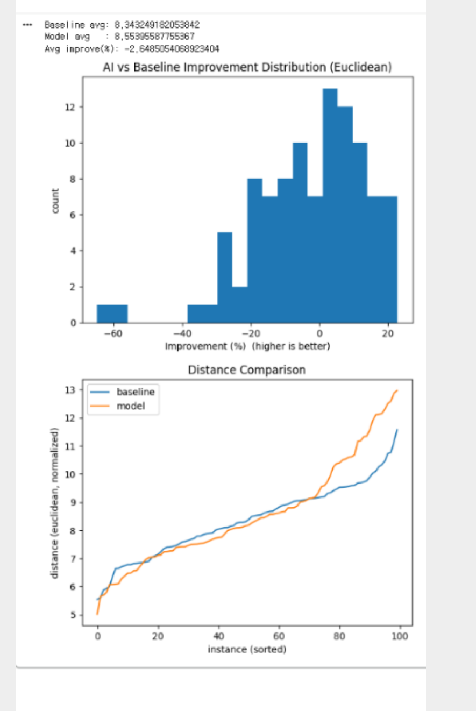
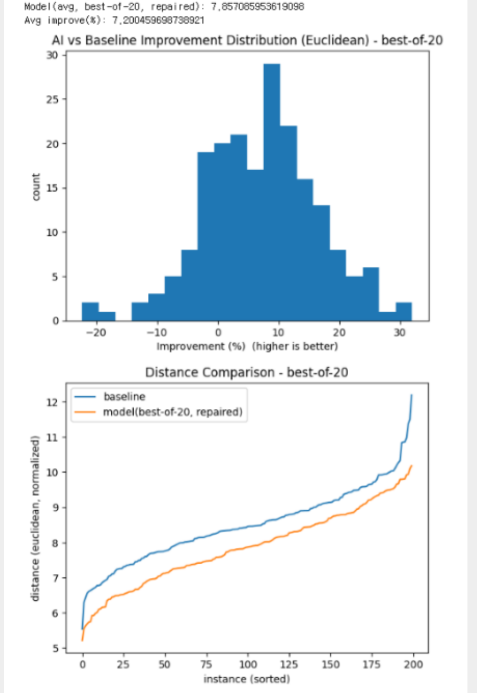
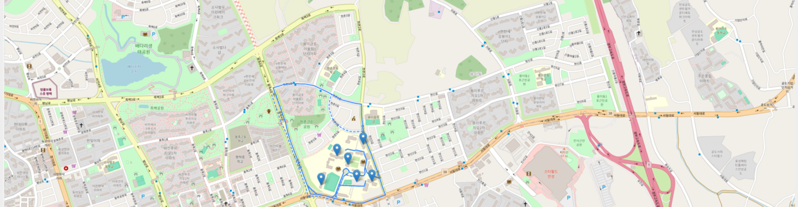

# 🚚 자동배송 시스템 (CVRP Road)
## AI 기반 용량 제약 배송 경로 최적화(CVRP) + 실제 도로 경로(OSRM) 웹 데모

<div align="center">

[](https://fastapi.tiangolo.com/)
[](https://pytorch.org/)
[](https://leafletjs.com/)
[](https://render.com/)

**“지도에서 장소를 찍으면, AI가 회차(Trip)를 나눠 최적 배송 경로를 제안합니다.”**

**Live Demo:** https://cvrp-road-demo.onrender.com/

</div>

---

## 📌 개요

**자동배송 시스템 (CVRP Road)** 는 물류 현장에서 자주 등장하는 **CVRP(Capacitated Vehicle Routing Problem)** 를 대상으로,  
딥러닝 기반 경로 생성 모델이 고객 방문 순서를 예측하고, **용량(capacity) 초과 시 자동으로 회차(Trip)를 분할**하며,  
각 회차의 이동은 **OSRM 도로 라우팅**으로 실제 도로 거리/시간까지 계산해 시각화하는 웹 데모입니다.

- **CVRP**: 각 고객의 수요(demand)를 싣고 배송할 때, 차량 용량(capacity)을 넘지 않도록 경로를 구성하는 최적화 문제
- 본 프로젝트는 “모델 출력 → 회차 분할 → 도로 거리/시간 계산 → 지도 시각화”까지 **실사용 흐름에 가깝게 연결**했습니다.


### 개발 정보
- **기간**: 2025.09 ~ 2025.12
- **인원**: 1명 (개인 프로젝트 · 모델 학습, 백엔드, 프론트엔드, 배포)

### 배경
- 배송지가 많아질수록 사람이 최적 경로를 직접 짜기 어렵고, 비효율은 시간·연료비·인건비 증가로 이어집니다.
- 차량 용량 안에서 몇 회차로 나눌지까지 함께 고려해야 해 문제 난이도가 크게 올라갑니다.
- CVRP는 NP-hard 문제로, 최근에는 Transformer/Pointer Network 같은 딥러닝 휴리스틱으로 빠르게 좋은 해를 찾는 연구가 활발합니다.

---

## 🎯 목표

- 사용자가 **지도에서 배송 지점(창고 + 고객)** 을 쉽게 구성
- 고객마다 **물류량(demand)** 을 설정
- AI가 **방문 순서 + 회차 분할(trip split)** 을 자동 생성
- OSRM으로 각 회차의 **도로 거리(km) / 시간(분)** 을 계산
- 결과를 표/지도(Polyline)로 제공하여 **설명 가능한 데모**로 제시

---

## 👥 타겟

- **웹 서비스(Web Demo)** 형태  
  - 발표/데모 목적: 브라우저에서 바로 실행 가능  
  - 물류 최적화/AI 경로 생성 연구 결과를 쉽게 시연 가능

---

## ✨ 핵심 기능

### 1) 장소 검색 (Kakao Local API)
- 키워드 기반 장소 검색 결과 리스트 제공
- 검색 결과 클릭 → 지도에 마커 추가
- (Fallback) 키가 없으면 Nominatim(OpenStreetMap)으로 검색 가능

### 2) 배송 지점 관리
- 첫 번째 지점은 **창고(Depot)**
- 이후 지점은 **고객(Customer)**
- 고객 마커 클릭 시 **demand 수정**
- 고객 삭제 시 인덱스 재정렬 + UI 동기화

### 3) AI 기반 경로 생성 + 회차 분할
- 모델이 예측한 경로에서 **고객 방문 순서만 추출**
- **capacity 기준으로만** depot 복귀를 삽입하여 회차를 구성 (불필요한 depot 반복 제거)

### 4) 도로 거리/시간 계산(OSRM)
- 각 trip별 좌표를 OSRM에 전달
- polyline을 지도에 표시 + 표에 **km/min** 요약

---

## 🧠 AI 모델(딥러닝) 개요

본 프로젝트 모델은 **Transformer Encoder + Pointer-style Decoder** 구조입니다.

### 입력(노드 특징)
각 노드는 다음 3개 feature로 구성됩니다.
- `(x, y)` : 좌표
- `demand_ratio = demand / capacity` : 용량 대비 수요 비율

### Encoder (Transformer)
- 모든 노드(Depot + Customers)를 임베딩 후 Transformer Encoder로 인코딩
- 결과: 각 노드의 문맥 임베딩 `h (B, N, E)` + 전체 요약 `global_ctx`

### Decoder (Pointer)
- 현재 위치 노드 임베딩 + global_ctx + remaining_capacity 정보를 결합해 query 생성
- 모든 노드에 대한 pointer logits를 계산하여 다음 방문 노드를 선택
- **Masking**으로
  - 이미 방문한 고객
  - 남은 용량보다 demand_ratio가 큰 고객  
  을 선택하지 못하도록 제한

### 디코딩 방식
- `greedy` : 항상 최고 확률 노드 선택 (데모에서 사용)
- `sampling` : 확률적으로 샘플링 (RL/탐색 성능 향상 실험용)

---

## 🔁 “회차(Trip) 분할” 방식

현실 배송에서는 **용량(capacity)** 이 핵심 제약입니다.  
따라서 모델 출력이 depot(0)을 불필요하게 많이 찍는 경우가 있어도, 본 프로젝트는 다음 정책으로 안정화했습니다.

### ✅ Capacity-only Trip Split (핵심 아이디어)
1. 모델 path에서 **고객 방문 순서만 추출**
   - `0(depot)` 제거
   - 중복 고객 제거
   - 누락 고객은 뒤에 안전하게 추가
2. 고객들을 순서대로 담되,
   - `load + demand > capacity` 가 되는 순간에만 depot 복귀(회차 종료)
3. 결과적으로 “필요할 때만 depot 복귀”하는 자연스러운 trip이 생성됩니다.

> 발표 포인트: **“모델이 0을 남발해도, 실제 운영 규칙(용량) 기반으로 후처리하여 안정적 데모를 구현”**

---

## 📈 학습/평가 (Colab)

Colab에서 다음 흐름으로 성능을 점검했습니다.

- Baseline: **Nearest Neighbor + Capacity constraint**
- Model: Transformer+Pointer 모델 경로 생성 → **capacity-only repair 후 평가**
- 평가 지표: 유클리드 거리 기반 비교(정규화 좌표)

그래프(예시):
- improvement histogram (개선 분포)
- sorted distance plot (인스턴스별 거리 비교)
- worst-case 디버그 출력(불필요 depot 방문 제거 확인)

### 결과

| 실험 | Baseline 평균 거리 | 모델 평균 거리 | 평균 개선율 |
|---|---|---|---|
| 초기 모델 (후처리 전) | 8.343 | 8.554 | **−2.65%** |
| capacity-only repair + best-of-20 샘플링 | 8.494 | 7.857 | **+7.20%** |

*거리: 정규화 좌표 기준 유클리드 거리 · 개선율: (Baseline − Model) / Baseline · 두 실험은 서로 다른 평가 인스턴스 묶음에서 측정*

| 초기 모델 | repair + best-of-20 |
|---|---|
|  |  |

### 문제와 해결
- **문제**: 초기 모델은 창고(depot) 복귀를 불필요하게 반복 출력해, Baseline보다 평균 거리가 오히려 길었고 일부 인스턴스는 −60%까지 나빠졌습니다.
- **해결 1 · capacity-only repair**: 모델 경로에서 고객 방문 순서만 추출하고, 적재량을 넘기는 순간에만 창고로 복귀하도록 후처리했습니다.
- **해결 2 · best-of-20 샘플링**: sampling 디코딩으로 후보 20개를 만들고 그중 가장 짧은 경로를 선택했습니다.
- **결과**: 평균 개선율이 −2.65% → **+7.20%** 로 바뀌었고, 극단적으로 나빠지는 케이스가 줄었습니다.

---

## 🖥️ 실행 화면



회차별 경로를 지도 polyline으로 표시하고, 회차별 적재량·도로 거리·소요 시간을 표로 요약합니다.

---

## 🗺️ 시스템 구성(아키텍처)

[Web UI: Leaflet/JS]
├─ 장소 검색 요청 ───────────────► [FastAPI /geocode] ─► Kakao Local API
├─ AI Solve 요청 ───────────────► [FastAPI /solve] ─► CVRPModel (PyTorch)
└─ 도로 라우팅 요청 ─────────────► [FastAPI /route] ─► OSRM (public)
◄────────────── 결과(trips, km/min, polyline)


---

## 🛠️ 기술 스택

- **Backend**: FastAPI, Python, requests
- **AI**: PyTorch (Transformer Encoder + Pointer Decoder)
- **Map UI**: Leaflet
- **Geocoding**: Kakao Local API (키워드/주소 검색), fallback Nominatim
- **Routing**: OSRM public API
- **Deploy**: Render

---

## 🔑 환경 변수 (중요)

### Render Environment Variables
- `KAKAO_REST_API_KEY` : Kakao Local REST API Key
- `CVRP_MODEL` : 모델 체크포인트 경로 (선택)  
  - 예: `checkpoints/best.pt`

✅ **주의**: API 키는 코드에 하드코딩하지 않고 **환경변수로만** 관리합니다.

---

## 📡 API 엔드포인트

- `GET /` : 웹 UI(index.html)
- `GET /health` : 서버 상태 확인(배포 깨우기 용)
- `GET /geocode?q=...&limit=30` : 장소 검색
- `POST /solve` : AI 경로 생성 + capacity-only trip split
- `POST /route` : OSRM 도로 경로(polyline) + 거리/시간

---

## 🧪 로컬 실행 방법

### 1) 의존성 설치
```bash
pip install -r requirements.txt
```

### 2) 환경 변수 설정
```bash
# mac/linux
export KAKAO_REST_API_KEY="YOUR_KEY"

# windows powershell
setx KAKAO_REST_API_KEY "YOUR_KEY"
```

### 3) 실행
```bash
uvicorn api.app:app --host 0.0.0.0 --port 8000 --reload
```
접속: http://localhost:8000

---

## 📁 프로젝트 구조

```text
cvrp-road-demo/
├─ api/
│  └─ app.py                 # FastAPI 서버 (geocode/solve/route)
├─ cvrp/
│  ├─ model.py               # CVRPModel (Transformer + Pointer)
│  └─ data.py                # route_length 등 유틸
├─ web/
│  └─ index.html             # Leaflet UI
├─ checkpoints/
│  └─ best.pt
├─ docs/images/              # README 이미지
└─ README.md
```
